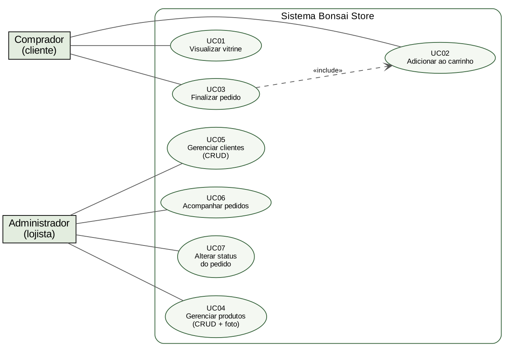
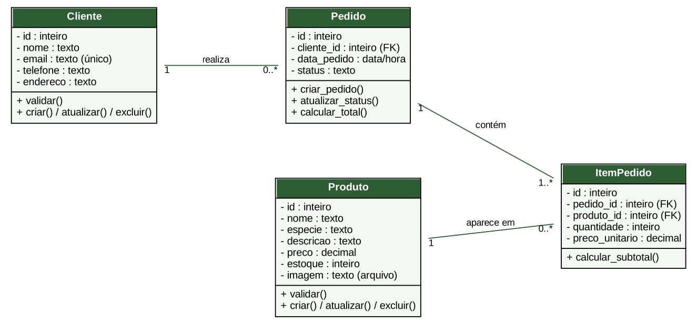
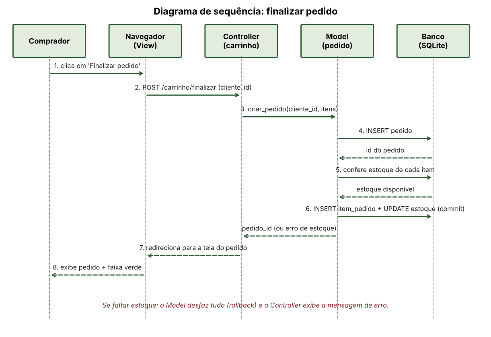
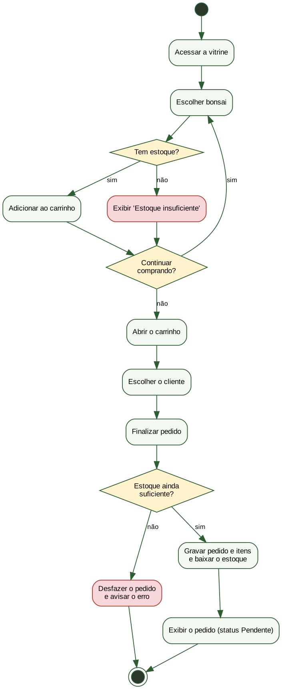

# 02 – Modelagem UML (revisada) – Bonsai Store

**Versão:** 2 (substitui a versão do PI I, mantida em `Docs/02 – Modelagem_UML.md.txt` para histórico)

## 1. Diagrama de casos de uso

**Atores**

- **Comprador (cliente):** navega pela vitrine, monta o carrinho e finaliza pedidos.
- **Administrador (lojista):** gerencia produtos, clientes e pedidos.

| Caso de uso | Ator | Descrição | Fluxo principal |
|---|---|---|---|
| UC01 – Visualizar vitrine | Comprador | Ver os bonsais disponíveis com foto, preço e estoque | 1. Acessa a página inicial. 2. O sistema lista os produtos em cartões. |
| UC02 – Adicionar ao carrinho | Comprador | Colocar 1 unidade de um bonsai no carrinho | 1. Clica em "Adicionar ao carrinho". 2. O sistema confere o estoque. 3. O item entra no carrinho e o contador do menu é atualizado. |
| UC03 – Finalizar pedido | Comprador | Transformar o carrinho em um pedido | 1. Abre o carrinho. 2. Escolhe o cliente. 3. Clica em "Finalizar pedido". 4. O sistema grava o pedido, baixa o estoque e mostra o pedido. |
| UC04 – Gerenciar produtos | Administrador | Cadastrar, listar, editar e excluir produtos, com foto | 1. Acessa "Produtos". 2. Escolhe a ação. 3. Preenche o formulário. 4. O sistema valida e salva. |
| UC05 – Gerenciar clientes | Administrador | Cadastrar, listar, editar e excluir clientes | Igual ao UC04, com os dados do cliente. |
| UC06 – Acompanhar pedidos | Administrador | Consultar os pedidos e seus itens | 1. Acessa "Pedidos". 2. Abre o detalhe de um pedido. |
| UC07 – Alterar status do pedido | Administrador | Atualizar o andamento do pedido | 1. Abre o pedido. 2. Escolhe o novo status. 3. O sistema atualiza. |

**Fluxos alternativos e de exceção**

- **UC02:** se não houver estoque suficiente, o sistema mostra "Estoque insuficiente" e não adiciona o item.
- **UC03:** se o carrinho estiver vazio ou nenhum cliente for escolhido, o sistema mostra a mensagem de erro e mantém o carrinho.
- **UC03:** se o estoque acabar antes da finalização, o pedido é desfeito por completo e o usuário é avisado.
- **UC04 e UC05:** dados inválidos (nome vazio, preço inválido, e-mail inválido ou repetido) são recusados com mensagem clara.
- **UC04 e UC05:** produto ou cliente que já tem pedidos não pode ser excluído.

## 2. Diagrama de classes

| Classe | Responsabilidade |
|---|---|
| **Produto** | Representa um bonsai à venda (nome, espécie, descrição, preço, estoque e foto) |
| **Cliente** | Representa quem compra (nome, e-mail único, telefone e endereço) |
| **Pedido** | Registra uma compra de um cliente, com data e status |
| **ItemPedido** | Liga um pedido a um produto, guardando a quantidade e o preço da época da compra |

**Relacionamentos:** um cliente realiza zero ou mais pedidos; um pedido contém um ou mais itens; um produto pode aparecer em zero ou mais itens.

**Correspondência com a arquitetura MVC:** cada classe tem um módulo em `app/models` (regras e acesso ao banco) e, quando há tela própria, um controller em `app/controllers`.

## 3. Diagrama de sequência – finalizar pedido

## 4. Diagrama de atividades – fluxo de compra

## 5. Melhorias Kaizen na modelagem

| Antes (PI I) | Depois (PI II) |
|---|---|
| 2 classes (Produto e Usuario "opcional") | 4 classes com relacionamentos e multiplicidades |
| 5 casos de uso, todos sobre CRUD de produtos | 7 casos de uso, com dois atores e fluxos de exceção |
| Apenas diagrama de classes e de casos de uso | Acrescentados os diagramas de sequência e de atividades |
| Classe Produto com 4 atributos | Classe Produto com espécie, estoque e imagem |
| Classe "Usuario" sem uso no sistema | Substituída por **Cliente**, usada nos pedidos |
