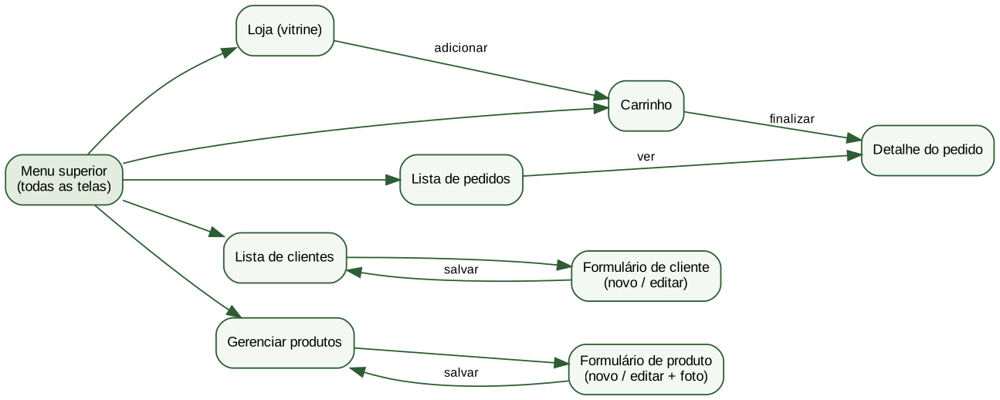

# 03 – IHC e Protótipo (revisado) – Bonsai Store

**Versão:** 2 (substitui a versão do PI I, mantida em `Docs/03 – IHC_Protótipo.md.txt` para histórico)

## 1. Princípios de IHC aplicados

Foram aplicados os princípios de interface estudados no material da disciplina:

| Princípio | Como aparece na Bonsai Store |
|---|---|
| **Clareza** | Títulos grandes, rótulos diretos ("Adicionar ao carrinho", "Finalizar pedido") e campos obrigatórios marcados com * |
| **Consistência** | Menu superior igual em todas as telas; botões verdes para ações e vermelhos para exclusão; mesmo formato de formulário em produtos e clientes |
| **Simplicidade** | Cada tela tem um único objetivo; formulários com poucos campos |
| **Controle do usuário** | O usuário decide quando adicionar, remover e finalizar; o botão "Cancelar" está sempre disponível nos formulários |
| **Recuperabilidade** | Itens podem ser removidos do carrinho; a exclusão pede confirmação; o formulário mantém o que foi digitado quando há erro |
| **Retorno imediato** | Faixa verde para sucesso e faixa vermelha para erro após cada ação; contador de itens no menu do carrinho |
| **Estética agradável** | Paleta verde, vitrine em cartões com foto e espaçamento generoso |

## 2. Mapa conceitual de navegação

## 3. Telas do sistema

| Tela | Endereço | Elementos principais |
|---|---|---|
| **Loja (vitrine)** | `/` | Cartões com foto, nome, espécie, descrição, preço e botão "Adicionar ao carrinho" (ou aviso "Esgotado") |
| **Carrinho** | `/carrinho/` | Tabela de itens, total, botão "Remover" por item, seleção do cliente e botão "Finalizar pedido" |
| **Detalhe do pedido** | `/pedidos/<n>` | Dados do cliente, itens, total e seletor de status |
| **Lista de pedidos** | `/pedidos/` | Número, data, cliente, status e total de cada pedido |
| **Gerenciar produtos** | `/produtos/` | Tabela com miniatura, nome, espécie, preço, estoque e botões Editar e Excluir |
| **Formulário de produto** | `/produtos/novo` e `/produtos/<n>/editar` | Nome, espécie, preço, estoque, descrição e envio de foto |
| **Lista de clientes** | `/clientes/` | Tabela com nome, e-mail, telefone e botões Editar e Excluir |
| **Formulário de cliente** | `/clientes/novo` e `/clientes/<n>/editar` | Nome, e-mail, telefone e endereço |
| **Erro** | qualquer endereço inexistente | Número e mensagem do erro, com botão para voltar à loja |

> Para a entrega, inserir neste documento os prints de cada tela (ver a pasta de evidências da Situação 3).

## 4. Mensagens de feedback e de erro

Todas as mensagens usam linguagem simples, sem termos técnicos, e dizem o que aconteceu e, quando possível, o que fazer.

**Sucesso (faixa verde)**

| Situação | Mensagem |
|---|---|
| Produto cadastrado | Produto cadastrado com sucesso! |
| Produto editado | Produto atualizado com sucesso! |
| Produto excluído | Produto excluído. |
| Cliente cadastrado | Cliente cadastrado com sucesso! |
| Pedido finalizado | Pedido realizado com sucesso! |
| Status alterado | Status do pedido atualizado. |

**Erro (faixa vermelha)**

| Situação | Mensagem |
|---|---|
| Nome do produto vazio | Informe o nome do produto. |
| Preço inválido | Informe um preço válido, por exemplo 89,90. |
| Preço zero ou negativo | O preço deve ser maior que zero. |
| Estoque negativo | O estoque não pode ser negativo. |
| Estoque não numérico | O estoque deve ser um número inteiro. |
| Imagem de tipo não permitido | A imagem deve ser PNG, JPG, GIF ou WEBP. |
| Imagem maior que 3 MB | A imagem é grande demais. O limite é de 3 MB. |
| E-mail inválido | Informe um e-mail válido, por exemplo nome@email.com. |
| E-mail já cadastrado | Já existe um cliente cadastrado com este e-mail. |
| Sem estoque ao adicionar | Estoque insuficiente de (nome do produto). |
| Carrinho vazio | Seu carrinho está vazio. |
| Cliente não escolhido | Escolha o cliente do pedido. |
| Estoque acabou na finalização | Estoque insuficiente de (produto) (disponível: n). |
| Produto com pedidos | Este produto já está em pedidos e não pode ser excluído. |
| Cliente com pedidos | Este cliente já tem pedidos e não pode ser excluído. |
| Página inexistente | Página não encontrada. |

## 5. Melhorias Kaizen na interface

| Antes (PI I) | Depois (PI II) |
|---|---|
| 4 telas apenas planejadas, sem imagens | 9 telas implementadas, com fotos dos bonsais |
| Lista simples de nome e preço | Vitrine em cartões com foto, espécie, descrição e preço |
| Sem mensagens de retorno | Faixas de sucesso e de erro em todas as ações |
| Navegação "escondida" para o cadastro | Menu fixo com acesso a todas as áreas |
| Botões e cores a definir | Padrão visual definido: verde para ações, vermelho para exclusão |
| Sem indicação do carrinho | Contador de itens do carrinho no menu |
| Tela de erro do navegador | Tela de erro própria, com opção de voltar |
