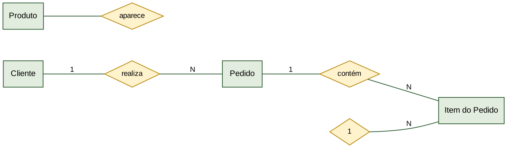
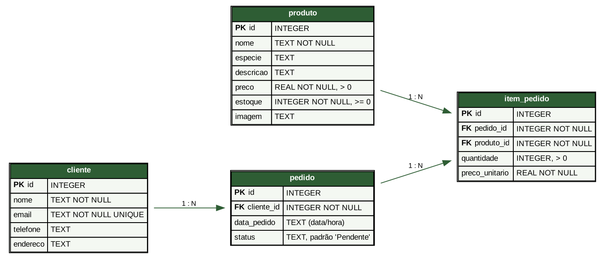

# 04 – Projeto de Dados (revisado) – Bonsai Store

**Versão:** 2 (substitui a versão do PI I, mantida em `Docs/04 – Projeto_de_Banco_de_Dados.md.txt` para histórico)
**SGBD:** SQLite (popular, de fácil manutenção, arquivo `bonsai.db` criado automaticamente)
**Script do projeto físico:** `schema.sql` (nesta mesma pasta), igual ao que `app/database.py` executa.

## 1. Modelo conceitual



**Entidades:** Cliente, Produto, Pedido e Item do Pedido.

**Relacionamentos**

- Um **cliente** realiza muitos **pedidos** (1:N).
- Um **pedido** contém muitos **itens** (1:N).
- Um **produto** aparece em muitos **itens** (1:N).
- A relação entre Pedido e Produto é muitos-para-muitos (um pedido tem vários produtos e um produto está em vários pedidos). Ela foi resolvida pela entidade associativa **Item do Pedido**, que também guarda a quantidade e o preço da compra.

## 2. Modelo lógico (normalizado)

```
produto     (id PK, nome, especie, descricao, preco, estoque, imagem)
cliente     (id PK, nome, email UNIQUE, telefone, endereco)
pedido      (id PK, cliente_id FK -> cliente, data_pedido, status)
item_pedido (id PK, pedido_id FK -> pedido, produto_id FK -> produto,
             quantidade, preco_unitario)
```

**Normalização**

- **1FN:** todos os campos guardam valores atômicos (não há listas dentro de uma coluna) e cada tabela tem chave primária.
- **2FN:** todas as chaves primárias são simples (`id`), portanto não existe dependência parcial.
- **3FN:** nenhum atributo depende de outro atributo que não seja a chave. O nome do cliente não é repetido em `pedido` e o nome do produto não é repetido em `item_pedido`: eles são obtidos por junção (JOIN).
- **Exceção intencional:** `preco_unitario` em `item_pedido` copia o preço do produto no momento da compra. Isso não é redundância indevida: é o histórico do que foi cobrado, que não pode mudar se o preço do produto for alterado depois.

## 3. Projeto físico



O script completo está em `schema.sql`. Resumo das regras de integridade:

| Regra | Onde |
|---|---|
| Chave primária com autoincremento | `id` de todas as tabelas |
| E-mail único | `cliente.email` (UNIQUE) |
| Preço maior que zero | `produto.preco` (CHECK) |
| Estoque não negativo | `produto.estoque` (CHECK) |
| Quantidade maior que zero | `item_pedido.quantidade` (CHECK) |
| Pedido sempre ligado a um cliente existente | `pedido.cliente_id` (FOREIGN KEY) |
| Item sempre ligado a pedido e produto existentes | `item_pedido.pedido_id` e `produto_id` (FOREIGN KEY) |
| Itens apagados junto com o pedido | `ON DELETE CASCADE` em `item_pedido.pedido_id` |
| Produto ou cliente com pedidos não podem ser excluídos | chaves estrangeiras sem CASCADE, com chaves estrangeiras ativadas (`PRAGMA foreign_keys = ON`) |
| Status inicial do pedido | `DEFAULT 'Pendente'` |
| Data do pedido automática | `DEFAULT (datetime('now', 'localtime'))` |

## 4. Dicionário de dados

### Tabela `produto`

| Campo | Descrição | Tipo | Obrigatório | Restrições | Exemplo |
|---|---|---|---|---|---|
| id | Identificador do produto | INTEGER | Sim | Chave primária, autoincremento | 1 |
| nome | Nome do bonsai | TEXT | Sim | Até 100 caracteres (validado no sistema) | Bonsai Ficus |
| especie | Espécie da planta | TEXT | Não | | Ficus |
| descricao | Descrição do produto | TEXT | Não | | Ideal para ambientes internos |
| preco | Preço de venda em reais | REAL | Sim | Maior que zero | 89.90 |
| estoque | Unidades disponíveis | INTEGER | Sim | Maior ou igual a zero; padrão 0 | 10 |
| imagem | Nome do arquivo da foto na pasta de uploads | TEXT | Não | PNG, JPG, GIF ou WEBP, até 3 MB (validado no sistema) | 3f9a1c.png |

### Tabela `cliente`

| Campo | Descrição | Tipo | Obrigatório | Restrições | Exemplo |
|---|---|---|---|---|---|
| id | Identificador do cliente | INTEGER | Sim | Chave primária, autoincremento | 1 |
| nome | Nome completo | TEXT | Sim | Até 100 caracteres (validado no sistema) | Ana Souza |
| email | E-mail do cliente | TEXT | Sim | Único; formato validado no sistema | ana@email.com |
| telefone | Telefone de contato | TEXT | Não | | 61999999999 |
| endereco | Endereço de entrega | TEXT | Não | | Quadra 10, Brasília |

### Tabela `pedido`

| Campo | Descrição | Tipo | Obrigatório | Restrições | Exemplo |
|---|---|---|---|---|---|
| id | Número do pedido | INTEGER | Sim | Chave primária, autoincremento | 1 |
| cliente_id | Cliente que fez o pedido | INTEGER | Sim | Chave estrangeira para `cliente.id` | 1 |
| data_pedido | Data e hora do pedido | TEXT | Sim | Preenchida automaticamente | 2026-11-15 14:30:00 |
| status | Andamento do pedido | TEXT | Sim | Pendente, Pago, Enviado ou Entregue (validado no sistema); padrão Pendente | Pendente |

### Tabela `item_pedido`

| Campo | Descrição | Tipo | Obrigatório | Restrições | Exemplo |
|---|---|---|---|---|---|
| id | Identificador do item | INTEGER | Sim | Chave primária, autoincremento | 1 |
| pedido_id | Pedido ao qual o item pertence | INTEGER | Sim | Chave estrangeira para `pedido.id`; exclusão em cascata | 1 |
| produto_id | Produto comprado | INTEGER | Sim | Chave estrangeira para `produto.id` | 2 |
| quantidade | Unidades compradas | INTEGER | Sim | Maior que zero | 2 |
| preco_unitario | Preço da unidade no momento da compra | REAL | Sim | | 89.90 |

## 5. Melhorias Kaizen no projeto de dados

| Antes (PI I) | Depois (PI II) |
|---|---|
| 1 tabela (`produtos`) | 4 tabelas relacionadas (produto, cliente, pedido, item_pedido) |
| Sem chaves estrangeiras | Chaves estrangeiras ativadas, protegendo a integridade |
| Sem restrições nos dados | CHECK em preço, estoque e quantidade; e-mail único |
| Sem controle de estoque | Campo `estoque`, baixado automaticamente a cada pedido |
| Sem foto do produto | Campo `imagem` |
| Preço do pedido dependeria do produto | `preco_unitario` guarda o preço da época da compra |
| Modelo lógico sem justificativa | Normalização até a 3FN documentada |
| Script SQL "a ser criado" | `schema.sql` pronto e testado |
